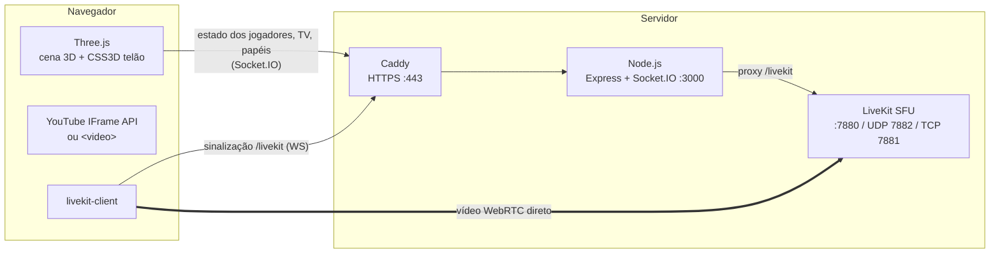
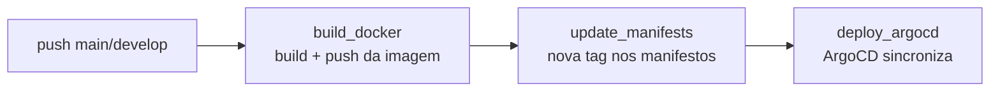

# 🎬 Projeto 3D — Cinema virtual multiplayer

Um cinema 3D no navegador para assistir filmes, vídeos e transmissões **junto com os amigos**, como se
todo mundo estivesse na mesma sessão de cinema. Cada pessoa entra com um bonequinho 3D, anda pela sala,
escolhe uma cadeira na arquibancada e assiste ao telão sincronizado com o resto da turma.

> **A ideia:** recriar a experiência de "ir ao cinema com a galera" a distância. Em vez de só mandar um
> link e cada um dar play na sua casa, todos ficam no mesmo espaço 3D, vendo a mesma cena no mesmo
> segundo, com presença, zoeira (tomates, bandeiras, sons) e alguém com o "controle remoto" da sala.

---

## Funcionalidades

### Sala e personagens
- **Salas privadas com código** de 6 caracteres (sem `0/O/1/I` para evitar confusão) e link para copiar.
- **12 personagens 3D** (pacote *Mini Characters* do Kenney, CC0) com animações de parado, andar,
  correr, pular e sentar.
- **Cinema em arquibancada**: telão 16:9 de 52 m, 10 fileiras em degraus, corredor central e escadas,
  pensado para todo mundo ver por cima das cabeças.
- **Sentar nas cadeiras** (`E`), com reserva do lugar no servidor (duas pessoas não sentam no mesmo).
- Câmera em **1ª ou 3ª pessoa**, lanterna, gravidade da lua e modo "3D caprichado" (sombras e resolução
  maior) para quem tem máquina forte.

### O telão
- **YouTube** (watch, `youtu.be`, shorts, embed, live) ou **arquivos de vídeo diretos** (`.mp4`, `.webm`, `.ogv`).
- **Sincronização pelo servidor**: a posição do vídeo é calculada no servidor, não no relógio de cada
  cliente. A correção de deriva é tolerante (2 s, com intervalo entre pulos) para não entrar no ciclo
  "pula → recarrega → atrasa" em redes lentas.
- **Transmissão de tela/aba** para o telão via **WebRTC + LiveKit (SFU)**: quem transmite envia uma
  cópia só e o LiveKit distribui para os espectadores. Áudio Opus estéreo em qualidade de música e
  prioridade para fluidez (filme), não nitidez.
- **Modo cinema** (`F`): o telão ocupa a tela inteira.
- Volume, mudo e **legendas do YouTube** individuais (valem só para você); o volume cai com a distância do telão.

### Papéis
- **Admin** (quem criou a sala): muda o ambiente (dia/noite) e pode retomar o controle.
- **Controle da TV**: só quem tem o controle carrega vídeo, dá play/pause/seek e transmite a tela.
  Pode ser passado para outro jogador. Se o admin sair, o jogador mais antigo assume.

### Interação
- 🍅 **Tomates** com física (arremesso, colisão com jogadores, chão e telão, respingos).
- 🚩 **Bandeiras** na mão do personagem (menores quando sentado, para não tapar a tela de quem está atrás).
  Vem com a bandeira do Brasil; dá para adicionar outras (ver [Adicionando bandeiras](#adicionando-bandeiras)).
- 🔊 **Sons do inventário**: qualquer áudio colocado em `sounds/` aparece na hora no jogo e todos ouvem.
  Dá para silenciar todos ou por pessoa. O repositório não traz sons, só a pasta pronta para recebê-los.

---

## Controles

| Tecla | Ação |
|---|---|
| `W A S D` / setas | Andar |
| `Shift` | Correr |
| `Espaço` | Pular |
| `E` | Sentar / levantar |
| `T` | Painel da TV |
| `F` | Modo cinema (tela cheia) |
| `Espaço` / `←` `→` / `↑` `↓` / `Z` | *(no modo cinema)* play/pause, ±10 s, volume, preencher tela |
| `M` | Mudo |
| `C` | Legendas do YouTube |
| `I` | Inventário (sons e bandeiras) |
| `G` | Jogar tomate |
| `L` | Lanterna |
| `V` | 1ª / 3ª pessoa |
| `Tab` | Quem está na sala e status da transmissão |
| `P` | 3D caprichado |
| `K` | Gravidade da lua |
| `Esc` | Fecha painéis / sai do modo cinema |

---

## Arquitetura



- **Frontend** (`public/`): JavaScript puro em módulos ES, sem bundler. `three` e `livekit-client` são
  servidos direto do `node_modules` via import map. O SDK do LiveKit só é baixado na primeira transmissão.
- **Backend** (`server.js`): Express + Socket.IO. O servidor é a **fonte da verdade** da sala (jogadores,
  cadeiras, estado da TV, papéis) e **valida tudo** que o cliente manda: nomes, modelos, bandeiras,
  links, velocidade e origem dos tomates, rate limit, permissão de controle.
- **LiveKit**: o jogo gera o JWT (HS256) do LiveKit; só quem está transmitindo recebe permissão de
  publicar, e só as fontes `screen_share`/`screen_share_audio`.
- **Caddy**: HTTPS é obrigatório para `getDisplayMedia` (transmitir tela). Na rede local usa a CA interna
  com `on_demand_tls`, autorizada só para IPs e `localhost` pelo endpoint `/tls-ask`.

### Estrutura

```
.
├── server.js                 # servidor de salas, validação, proxy do LiveKit, JWT
├── public/
│   ├── index.html            # lobby, HUD e painéis
│   ├── style.css
│   ├── js/
│   │   ├── main.js           # loop do jogo, controles, rede
│   │   ├── world.js          # cinema: telão, arquibancada, cadeiras, cenário
│   │   ├── character.js      # personagens GLB, animações, lanterna e bandeira
│   │   ├── tv.js             # player sincronizado (YouTube/vídeo) e modo cinema
│   │   ├── screenshare.js    # transmissão de tela via LiveKit
│   │   ├── tomatoes.js       # física dos tomates e respingos
│   │   └── flags.js          # bandeiras desenhadas em canvas
│   └── models/characters/    # modelos Kenney (CC0)
├── sounds/                   # sons do inventário (vazia no repo; montada no container)
├── docker/Dockerfile
├── docker-compose.yml        # app + LiveKit + Caddy + geração de segredo
├── deploy/                   # Caddyfile e livekit.yaml
└── .gitea/workflows/         # CI/CD: build → manifestos → ArgoCD
```

---

## Como rodar

### Desenvolvimento (sem transmissão de tela)

```bash
npm install
npm run dev        # node --watch, recarrega ao salvar
# http://localhost:3000
```

Sem LiveKit configurado o jogo funciona normalmente; só a transmissão de tela fica desativada.

### Docker Compose (stack completa, rede local)

```bash
docker compose up -d --build
```

Abra `https://IP-DA-MÁQUINA` nos outros computadores da rede. Na primeira visita o navegador mostra um
aviso de certificado (CA interna do Caddy): **Avançado → Continuar**. Não precisa de `.env`:

- o serviço `secrets` gera a chave da API do LiveKit **uma vez** e guarda num volume compartilhado;
- o LiveKit roda em `network_mode: host` para anunciar os IPs reais da máquina (o vídeo vai direto pela
  UDP `7882`, ou TCP `7881` como reserva — não precisa abrir faixa de portas);
- acessos diretos em `http://IP:3000` são redirecionados para o HTTPS.

Para um servidor na internet com domínio, troque o bloco `:443` do [deploy/Caddyfile](deploy/Caddyfile)
pelo bloco com domínio (Let's Encrypt automático) e publique a porta 80.

### Variáveis de ambiente

| Variável | Padrão | Descrição |
|---|---|---|
| `PORT` | `3000` | Porta HTTP do jogo |
| `MAX_PLAYERS_PER_ROOM` | `20` | Limite por sala (medido: acima disso a fluidez cai com vídeo tocando) |
| `SOUNDS_DIR` | `./sounds` | Pasta dos sons do inventário |
| `LIVEKIT_URL` | `http://127.0.0.1:7880` | Endereço interno do LiveKit |
| `LIVEKIT_PUBLIC_URL` | *(vazio)* | URL pública do LiveKit; vazio = `wss://<domínio do jogo>/livekit` |
| `LIVEKIT_KEYS` / `LIVEKIT_KEY_FILE` | — | Chave `chave: segredo` do LiveKit (direto ou por arquivo) |
| `HTTPS_REDIRECT_PORT` | — | Se definido, redireciona HTTP externo para HTTPS nessa porta |

### Adicionando sons

Coloque arquivos `.mp3`, `.ogg`, `.wav` ou `.m4a` em `sounds/`. Eles aparecem na hora em
**Inventário (I) → Sons**, sem reiniciar o servidor nem refazer a imagem (no Docker Compose a pasta é
montada no container). O nome exibido é o do arquivo, sem extensão, com `-` e `_` virando espaço.

> O repositório não traz arquivos de áudio: cada instalação coloca os seus. Cuidado com direitos autorais
> e com o conteúdo, já que todos na sala ouvem.

### Adicionando bandeiras

As bandeiras são desenhadas em canvas (sem imagens externas). Para criar uma nova:

1. adicione um objeto `{ id, label, draw(ctx) }` em `FLAGS` no [public/js/flags.js](public/js/flags.js);
2. inclua o mesmo `id` em `FLAG_IDS` no [server.js](server.js), já que o servidor recusa bandeiras desconhecidas.

---

## CI/CD e operação

Pipeline no **Gitea Actions** ([.gitea/workflows/ci-cd.yaml](.gitea/workflows/ci-cd.yaml)), disparada em
push para `main` e `develop`. O repositório não tem lógica de pipeline própria: ele só chama os
**workflows reutilizáveis** de `projetos-periodo-8/pipelines` (`@main`). Assim, qualquer melhoria na esteira
vale para todos os projetos da organização de uma vez.



1. **build_docker**: faz o build de `docker/Dockerfile` e o push para o registry em `vars.URL`. Devolve
   `image_name`, `image_tag` e `branch_slug` para os próximos jobs;
2. **update_manifests**: grava a nova tag da imagem no repositório de manifestos da organização (GitOps);
3. **deploy_argocd**: dispara a sincronização da aplicação no ArgoCD (um ambiente por branch, via `branch_slug`).

Nada no workflow está fixo em um ambiente. Registry e organização vêm de **variáveis do Gitea Actions**,
então o mesmo arquivo serve para outra organização ou outro registry sem mudar código:

| Variável (Actions → Variables) | Uso |
|---|---|
| `URL` | Endereço do registry de contêineres (ex.: `gitea.exemplo.com.br`) |
| `ORGANIZACAO` | Organização dona do repositório de manifestos e da aplicação no ArgoCD |

Os segredos (credenciais do registry, token dos manifestos, token do ArgoCD) vão para os workflows
compartilhados com `secrets: inherit`. Por isso precisam estar cadastrados na organização ou no repositório,
com os nomes que `projetos-periodo-8/pipelines` espera.

Pronto para container/Kubernetes:

- `GET /healthz` para health check (usado no `HEALTHCHECK` do Dockerfile);
- encerramento gracioso em `SIGTERM`/`SIGINT` (fecha conexões em até 5 s), além de `init: true` no compose;
- imagem `node:22-alpine` com `npm ci --omit=dev`, rodando como usuário `node`;
- LiveKit com `read_only: true` e usuário sem privilégios; chave com permissão `600`.

---

## Créditos

- Personagens: [Kenney — Mini Characters](https://kenney.nl) (CC0), ver
  [public/models/characters/LICENSE-Kenney.txt](public/models/characters/LICENSE-Kenney.txt).
- [Three.js](https://threejs.org), [Socket.IO](https://socket.io), [LiveKit](https://livekit.io), [Caddy](https://caddyserver.com).
